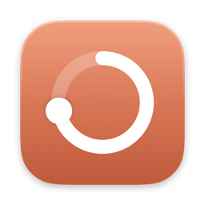
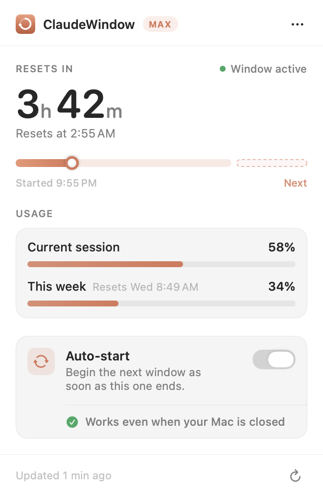
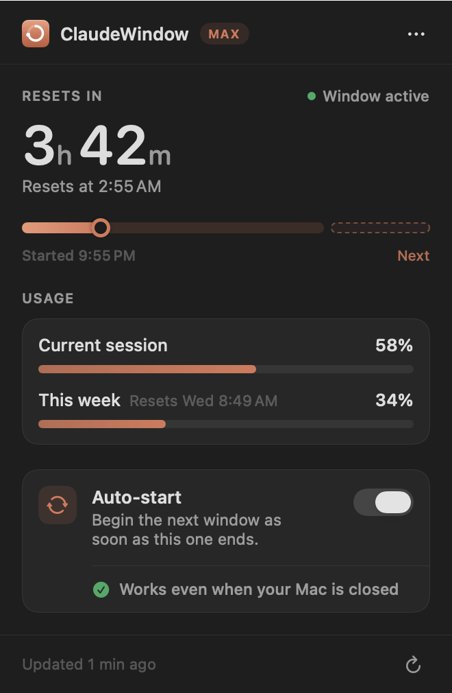
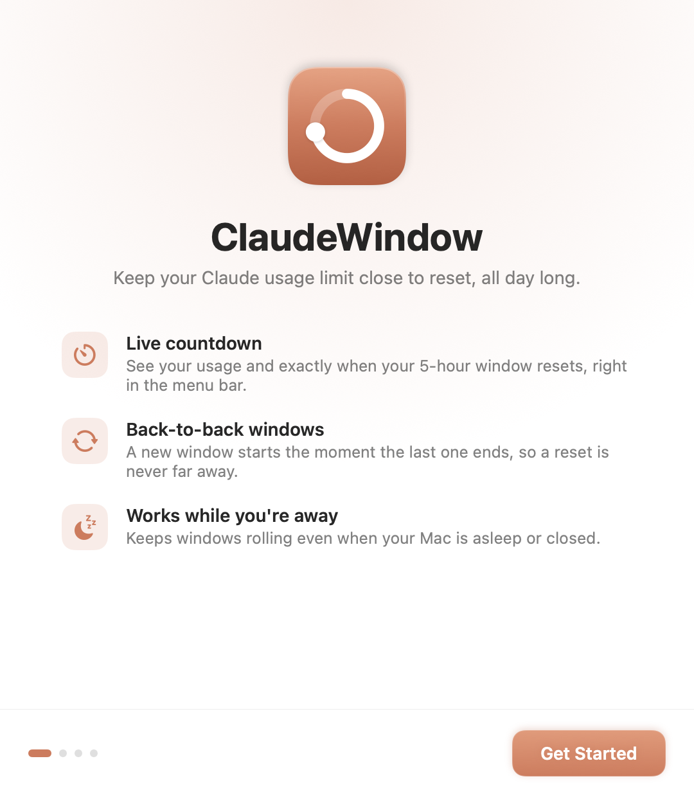
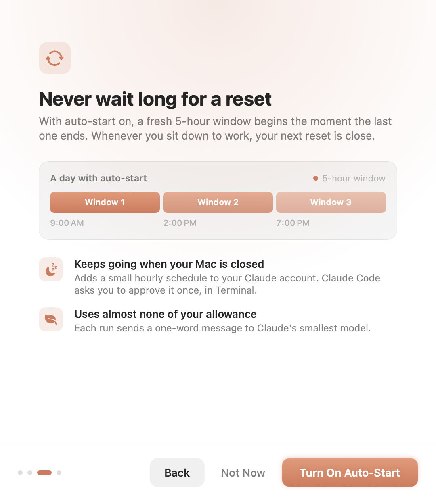

<p align="center">
  
</p>

<h1 align="center">ClaudeWindow</h1>

<p align="center">
  Keep your Claude usage limit close to reset, all day long.<br>
  A tiny macOS menu bar app for Claude Code users on Pro, Max and Team plans.
</p>

<p align="center">
  
  &nbsp;&nbsp;
  
</p>

## Why

Claude plans meter usage in **5-hour windows**. A window only starts when you send your first message, so if you sit down at 10:00 and hit the limit at 11:30, you wait until 15:00.

ClaudeWindow starts the next window the moment the last one ends. When you sit down to work, a window is already running and your next reset is never more than a few hours away.

## Features

- **Live countdown in the menu bar**: time until your window resets, plus session and weekly usage.
- **Auto-start**: begins a new window as soon as the previous one ends.
- **Works with your Mac closed**: an hourly cloud schedule on your Claude account keeps windows rolling while your Mac sleeps.
- **Guided setup**: finds Claude Code, checks your sign-in and walks you through everything.
- **Light and dark mode**, universal binary (Apple silicon and Intel), macOS 14 or later.

<p align="center">
  
  &nbsp;
  
</p>

## Install

1. Download **[ClaudeWindow-1.0.0.dmg](https://github.com/AryanAliPro/claudewindow/releases/latest)**.
2. Drag **ClaudeWindow** into **Applications** and open it.
3. Follow the setup window.

**New here? Read the [step-by-step setup guide](docs/SETUP.md).** It covers the macOS security warning, signing in, approving auto-start and troubleshooting.

You need [Claude Code](https://docs.claude.com/en/docs/claude-code/setup) installed and signed in with a Claude **Pro, Max, Team or Enterprise** plan. API-key accounts don't have 5-hour windows.

## How it works

ClaudeWindow never sees your password or tokens. It runs the `claude` command that's already on your Mac:

| What | How | Uses allowance? |
| --- | --- | --- |
| Show usage and reset time | `claude -p /usage` (no model call) | No |
| Start a window while your Mac is awake | `claude -p "Reply with just: ok"` on the smallest model | A tiny amount |
| Keep going while your Mac is closed | An hourly [routine](https://claude.ai/code/routines) named `ClaudeWindow` on your account that sends the same one-word message | A tiny amount, hourly |

Background calls run with no tools, no MCP servers, no hooks and no saved session history.

Creating the routine needs your approval: Claude Code shows the request in Terminal and you choose Yes. Each run appears as a short session in your Claude Code history. You can pause or delete it any time at [claude.ai/code/routines](https://claude.ai/code/routines).

## Uninstall

Open the menu bar panel, click **⋯ → Uninstall…**. This removes the app, its settings and the login item. If you turned on auto-start, also delete the `ClaudeWindow` routine at [claude.ai/code/routines](https://claude.ai/code/routines); the app opens that page for you.

## Build from source

```bash
git clone https://github.com/AryanAliPro/claudewindow.git
cd claudewindow
scripts/build.sh            # build/ClaudeWindow.app
scripts/build.sh --dmg      # also dist/ClaudeWindow-<version>.dmg
scripts/build.sh --install  # also copy to /Applications and open it
```

Needs the Xcode command line tools (`xcode-select --install`). No Xcode project, no dependencies.

To regenerate the README screenshots after a design change:

```bash
build/ClaudeWindow.app/Contents/MacOS/ClaudeWindow --snapshots docs/screenshots
```

### Releasing

Builds are signed ad-hoc by default, so macOS will warn people who download them. For a public release, sign with a Developer ID and notarize:

```bash
SIGN_IDENTITY="Developer ID Application: Your Name (TEAMID)" scripts/build.sh --dmg
xcrun notarytool submit dist/ClaudeWindow-*.dmg --keychain-profile <profile> --wait
xcrun stapler staple dist/ClaudeWindow-*.dmg
```

## Project layout

```
Sources/ClaudeWindow/
  main.swift            entry point and command-line helpers
  AppDelegate.swift     menu bar item, panel, setup window, uninstall
  Engine.swift          state: usage, auto-start, cloud schedule
  Support.swift         Claude Code CLI calls, parsing, formatting
  Theme.swift           colors, type and shared components
  PanelView.swift       the menu bar panel
  OnboardingView.swift  first-run setup
  Snapshots.swift       renders the icon and screenshots from code
Resources/              Info.plist, AppIcon.icns
scripts/build.sh        build, sign, package
```

## Disclaimer

ClaudeWindow is an independent open-source project. It is not made by, affiliated with or endorsed by Anthropic. "Claude" is a trademark of Anthropic. Automated messages count toward your plan's usage; check Anthropic's terms for your plan before enabling auto-start.

## License

[MIT](LICENSE)
