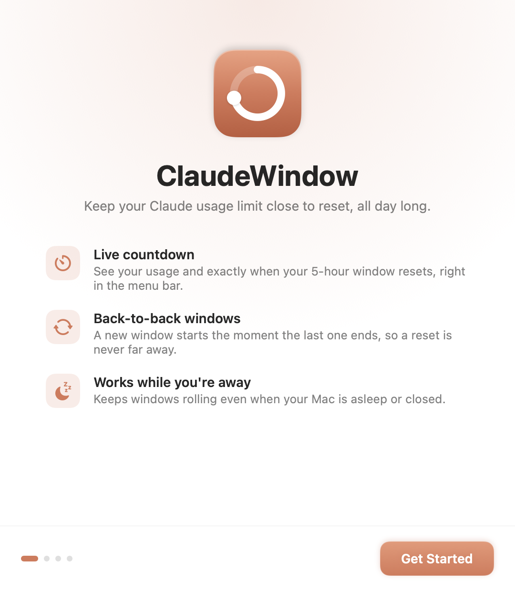
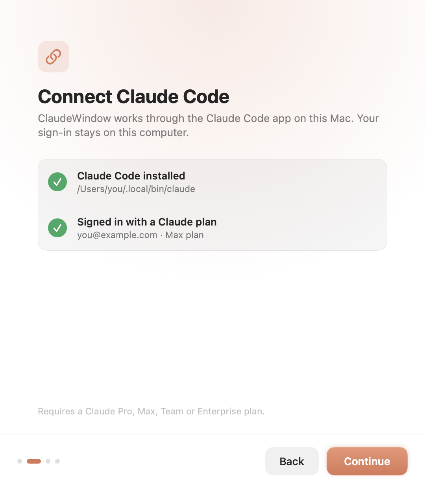
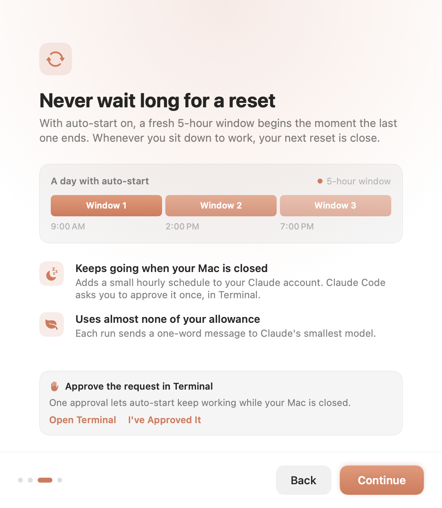
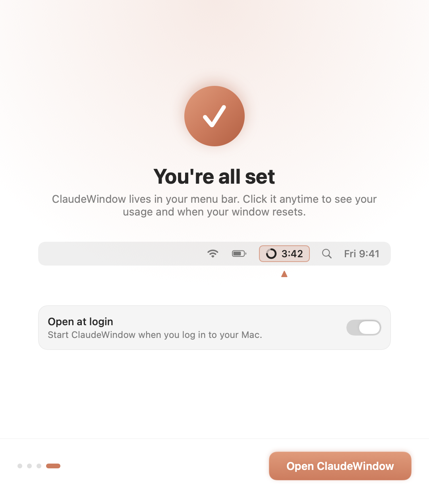
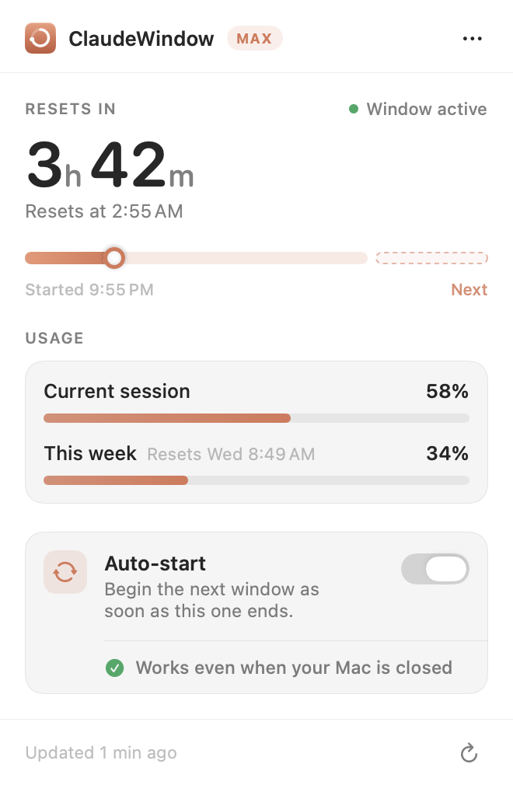

# Setup guide

This guide walks you through installing ClaudeWindow and getting auto-start running. It takes about five minutes.

## Before you start

You need:

- A Mac running **macOS 14 Sonoma or later** (Apple silicon or Intel).
- **Claude Code** installed. If you don't have it, run this in Terminal:

  ```bash
  curl -fsSL https://claude.ai/install.sh | bash
  ```

  Other install methods are in the [Claude Code docs](https://docs.claude.com/en/docs/claude-code/setup).
- A Claude **Pro, Max, Team or Enterprise** plan. Accounts that use an API key don't have 5-hour windows, so ClaudeWindow has nothing to track.

## 1. Install the app

1. Download **ClaudeWindow-1.0.0.dmg** from the [latest release](https://github.com/AryanAliPro/claudewindow/releases/latest).
2. Open the DMG and drag **ClaudeWindow** onto the **Applications** folder.
3. Open ClaudeWindow from Applications.

### "ClaudeWindow can't be opened" or "Apple could not verify…"

This release isn't notarized by Apple yet, so macOS warns you the first time. To open it anyway:

1. Try to open ClaudeWindow once and close the warning.
2. Open **System Settings → Privacy & Security**.
3. Scroll down to the message about ClaudeWindow and click **Open Anyway**, then confirm.

Or, in Terminal:

```bash
xattr -dr com.apple.quarantine /Applications/ClaudeWindow.app
```

You only need to do this once.

## 2. Welcome

The setup window opens by itself. Click **Get Started**.



## 3. Connect Claude Code

ClaudeWindow checks two things:

| Check | If it fails |
| --- | --- |
| **Claude Code installed** | Click **Install** for instructions, install it, then come back. The step updates on its own. |
| **Signed in with a Claude plan** | Click **Sign In**. Terminal opens and runs `claude auth login`. Choose your Claude account (not an API key), finish in the browser, then come back. |

When both show a green check, click **Continue**.



## 4. Turn on auto-start

Auto-start begins a new 5-hour window the moment the last one ends, so a reset is never far away.

Click **Turn On Auto-Start**. Two things happen:

- **While your Mac is awake**, ClaudeWindow starts windows itself.
- **To keep going while your Mac is closed**, ClaudeWindow adds a small hourly schedule (a "routine") to your Claude account. Claude Code requires your approval for this, so **Terminal opens with one request**:
  1. Read the short explanation at the top.
  2. When Claude Code asks for permission to use `RemoteTrigger`, choose **Yes**.
  3. When it says "All set", close the Terminal window.

Back in ClaudeWindow, the status changes to **Works even when your Mac is closed** within about a minute. If it doesn't, click **I've Approved It**.



Don't want the cloud part? Click **Not Now**. You can turn auto-start on later from the menu bar.

## 5. Done

Leave **Open at login** on so ClaudeWindow starts with your Mac, then click **Open ClaudeWindow**.



## Using ClaudeWindow

Click the ring in your menu bar.



- **Resets in**: time left in your current 5-hour window. The bar shows when it started, where you are now, and the next window queued behind it.
- **Usage**: how much of this window and this week you've used. The bars turn amber at 75% and red at 90%.
- **Auto-start**: on or off, and whether it's covering the time your Mac is closed.
- **⋯ menu**: Open at Login, Refresh Now, Setup Guide, Manage Cloud Schedule, About, Uninstall, Quit.

The menu bar shows a dashed ring when no window is running, and a ring with a dot when setup needs your attention.

## Troubleshooting

**"Couldn't read your usage"**
Run `claude` in Terminal and type `/usage`. If that fails, Claude Code itself needs fixing (often a fresh `claude auth login`).

**Auto-start says "Only while this Mac is awake"**
The approval in Terminal didn't go through. Click **Enable Closed-Lid Mode** to try again.

**The countdown seems off**
Click **⋯ → Refresh Now**. Usage refreshes on its own every 5 minutes and right after each reset.

**I see short "ok" sessions in my Claude Code history**
That's the hourly schedule starting your windows. Each one uses a tiny amount of your allowance.

**Pause or remove the cloud schedule**
Switch auto-start off in the panel (Terminal asks you to approve once), or go to [claude.ai/code/routines](https://claude.ai/code/routines) and pause or delete the routine named `ClaudeWindow`.

## Uninstall

Click **⋯ → Uninstall…** in the panel. This removes the app, its settings and the login item. If auto-start was on, ClaudeWindow also opens [claude.ai/code/routines](https://claude.ai/code/routines) so you can delete the `ClaudeWindow` routine.

To remove everything by hand instead:

```bash
pkill -x ClaudeWindow
rm -rf /Applications/ClaudeWindow.app "$HOME/Library/Application Support/ClaudeWindow"
defaults delete dev.claudewindow.app
```
